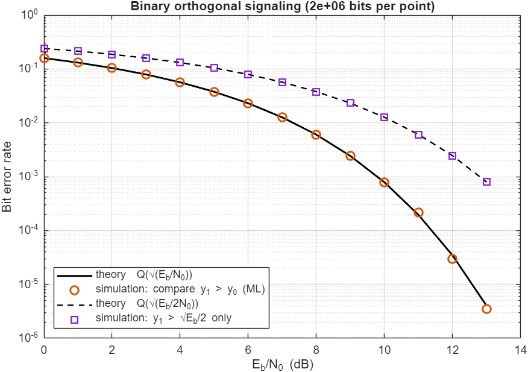
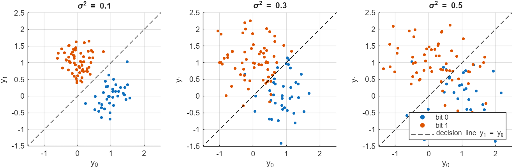
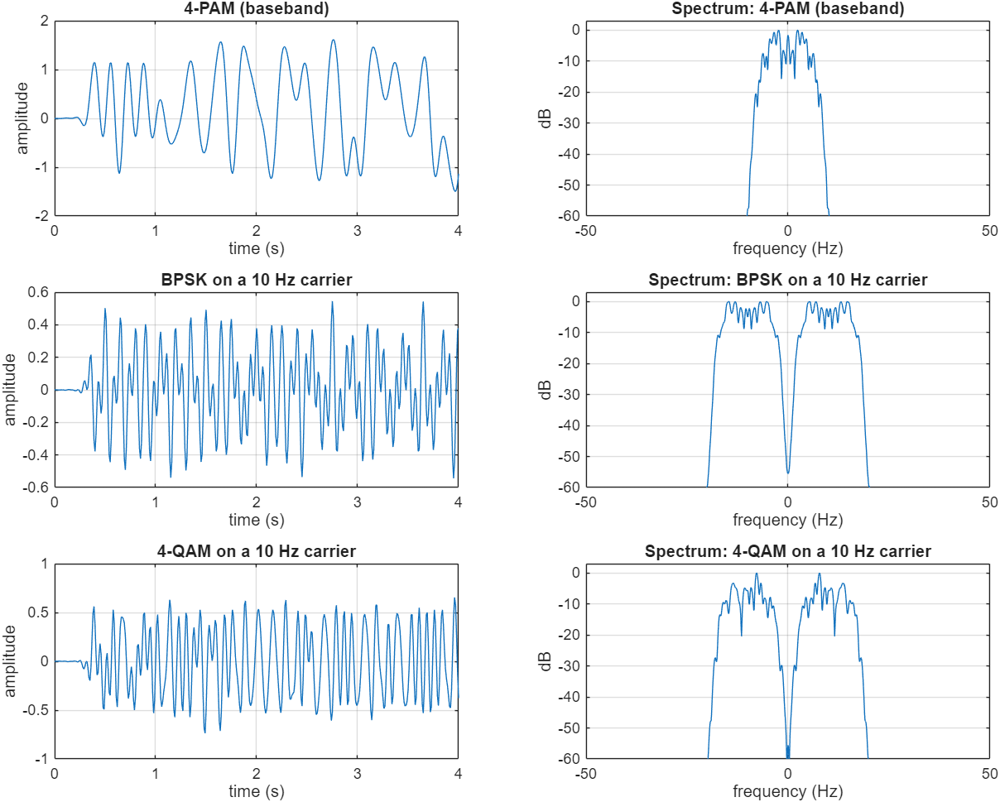
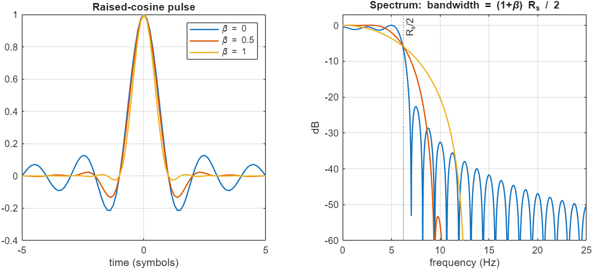
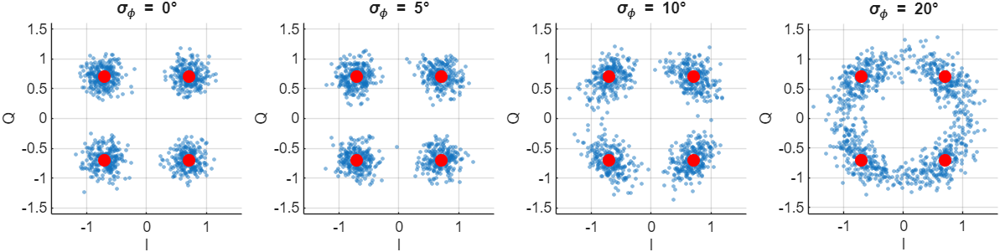
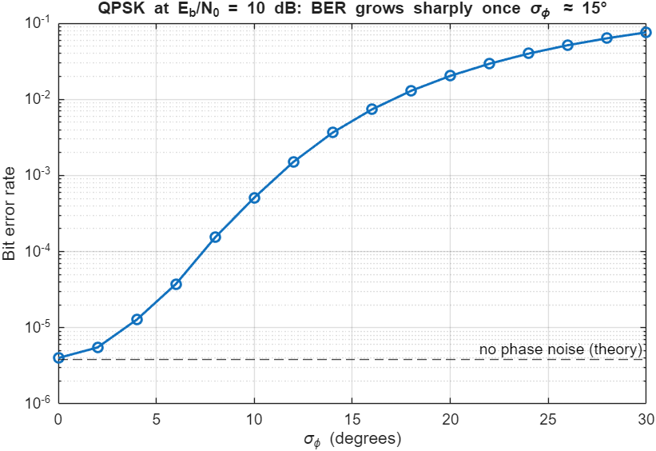
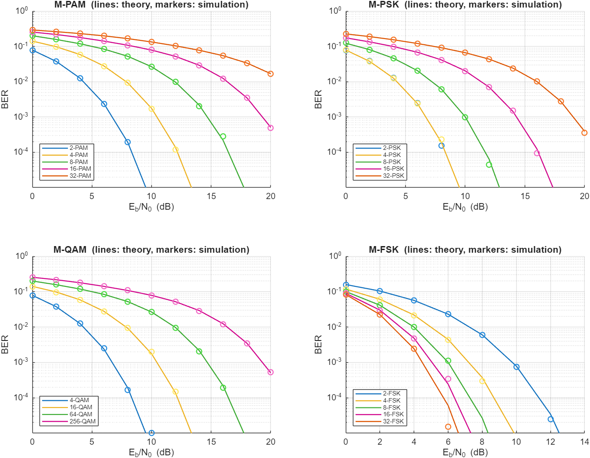
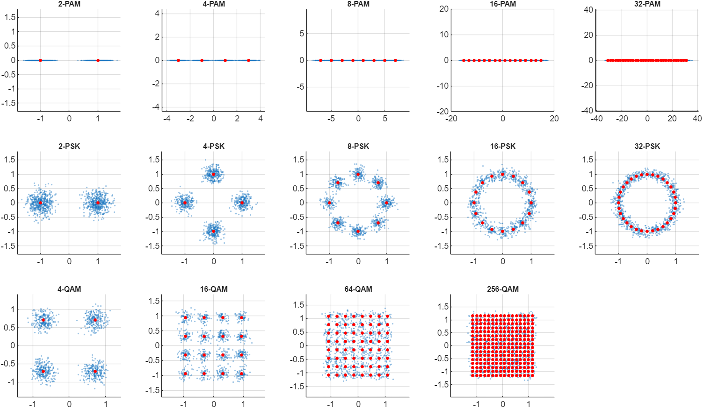

# Digital Modulation and BER Analysis in MATLAB (Digital Communications Lab, Experiment 1)

This repository contains Monte-Carlo simulations of digital modulation schemes, compared against theory:
- binary orthogonal signaling and its optimum detector
- the effect of noise on the decision variables
- raised-cosine pulse shaping (waveforms, spectra, roll-off)
- phase noise in QPSK
- the BER of **M-PAM, M-PSK, M-QAM and coherent M-FSK** for M up to 256

> **Course:** Digital Communications Lab, Amirkabir University of Technology, Spring 2026.

```matlab
>> run_all          % writes every figure to ./results  (MATLAB + Communications Toolbox)
```

## 1.1 Binary orthogonal signaling
Bit 0 is sent as $(\sqrt{E_b}, 0)$ and bit 1 as $(0, \sqrt{E_b})$ on two orthogonal signals. The receiver observes $y_0, y_1$ with independent $\mathcal N(0, N_0/2)$ noise.

- **Optimum detector.** With equal priors, the ML rule compares the likelihoods, and that reduces exactly to **choosing the larger of y₀ and y₁**. The decision variable $y_1-y_0$ has variance $N_0$ and mean ±√E_b, so $P_b = Q(\sqrt{E_b/N_0})$.
- **Single-branch detector.** A detector that only thresholds y₁ at √E_b/2 throws away half the information. Its error rate is $Q(\sqrt{E_b/2N_0})$, which is **3 dB worse**.
- **Orthogonal vs. antipodal.** Orthogonal signals need no phase reference (they can even be detected non-coherently), but they are 3 dB less efficient than antipodal signaling (BPSK, $Q(\sqrt{2E_b/N_0})$), because the two points are only √(2E_b) apart instead of 2√E_b.



## 1.2 Effect of the noise variance
With E_b = 1 and σ² = 0.1, 0.3 and 0.5, the outputs of the two branches spread more and more around 0 and 1. The two clusters in the (y₀, y₁) plane start to overlap the decision line y₁ = y₀:

$$P_e = Q\big(1/\sqrt{2\sigma^2}\big) = 0.013,\ 0.098,\ 0.159$$

σ² = 0.1 separates the bits most easily. At a fixed noise level, the error rate can only be reduced by **increasing E_b**, i.e. the signal energy or the bit duration. That raises E_b/N₀.



## 1.3 Raised-cosine pulse shaping
The test signals are 4-PAM (baseband) and BPSK and 4-QAM on a 10 Hz carrier, with f_s = 100 Hz, 8 samples per symbol, β = 0.5 and a span of 10 symbols.

- **Why a raised cosine.** The pulse has zero crossings at every other symbol instant, so there is **no ISI**. Its spectrum is band-limited to $(1+\beta)R_s/2$, here 9.4 Hz in baseband and 10 ± 9.4 Hz in passband.
- **Effect of β.** β trades bandwidth for time-domain decay. β = 0 is the minimum (Nyquist) bandwidth, but the sinc tails decay slowly and are very sensitive to timing errors. β = 1 doubles the bandwidth and gives a fast-decaying, robust pulse.
- **RC vs. RRC.** In practice a **root**-raised cosine (RRC) is used in both the transmitter and the receiver. Their cascade is a raised cosine (zero ISI), and the receive RRC is also the matched filter, so it maximises SNR.




## 1.4 Phase noise in QPSK (E_b/N₀ = 10 dB)
The received signal is $r = s\,e^{j\phi} + n$ with $\phi \sim \mathcal N(0,\sigma_\phi^2)$. Phase noise rotates every point **along its circle** (tangentially), so the scatter is not isotropic, unlike AWGN.

- **BER vs. σ_φ.** The BER rises from 4 × 10⁻⁶ (σ_φ = 0, the theoretical value) to 5 × 10⁻⁴ at 10° and 2 × 10⁻² at 20°. The relationship is strongly nonlinear: QPSK has a 45° decision margin, so errors explode once σ_φ is a sizeable fraction of it.
- **Higher-order QAM.** 16-QAM has outer points with smaller angular margins, so it is **more** sensitive.
- **Countermeasures.** Low-noise oscillators, PLL-based carrier recovery, pilot-aided phase tracking.




## 1.5 BER of M-PAM, M-PSK, M-QAM and M-FSK
The simulation runs 2 × 10⁵ bits per point with Gray mapping and E_b/N₀ from 0 to 20 dB. Lines are theory (`berawgn`) and markers are simulation; they agree in every case.



- **PAM, PSK and QAM.** For the same M, **QAM performs best**, then PSK, then PAM. QAM uses both dimensions and spreads points over a square. PSK puts them on a circle, so the minimum distance shrinks like sin(π/M). PAM uses only one dimension.
- **The cost of larger M.** Increasing M packs more bits per symbol (better spectral efficiency) but needs much more E_b/N₀: about 4 dB more per doubling of bits for QAM.
- **FSK is the exception.** Its BER *improves* with M, because the signals stay orthogonal. The price is that the bandwidth grows in proportion to M.
- **Choosing a scheme.** In a band-limited channel, square M-QAM (with adaptive M) gives the best rate for a given BER. In a power-limited channel, M-FSK or low-order PSK is better.
- **Simulation vs. theory.** The remaining differences come from finite-sample statistics at low BER and from the union-bound and nearest-neighbour approximations in the textbook formulas.



## Changes compared with the original lab submission
- **1.1:**
  - The script plotted error *counts* on a linear axis, with swapped legend labels. It used only 1000 bits, so no errors could be seen beyond about 7 dB.
  - The detector called "maximum likelihood" (y₁ > √E_b/2) is actually the 3 dB-worse single-branch detector. The comparison detector *is* ML.
- **1.2:** both outputs were generated from the same mean vector (`y1 = m0 + n1`), so bit 1 was never visible.
- **1.3:** the required spectra and the roll-off comparison were missing.
- **1.4:** the BER used only 1000 symbols, so it read 0 below about 10⁻³. The SNR passed to `awgn` was E_b/N₀ instead of E_s/N₀ (3 dB off for QPSK).
- **1.5:**
  - M-FSK was missing, and so were the theory curves.
  - The PAM noise level was correct, though only by accident: `pammod` returns a complex-typed array, so `awgn` split the noise over I and Q. The new code makes the PAM signal explicitly real and scales the SNR accordingly.
- **Structure:** everything is now one reproducible `run_all` with a fixed seed.

## Skills
Digital modulation and detection theory · Monte-Carlo BER simulation · pulse shaping · phase noise · MATLAB Communications Toolbox

## Author
**Sepehr Ebrahimi**, B.Sc. Electrical Engineering, Amirkabir University of Technology (2026)
